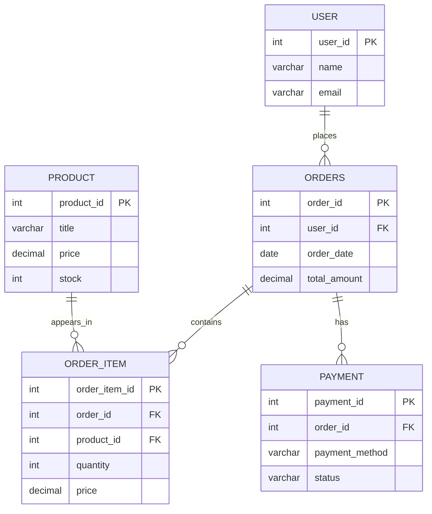

# E-Commerce Intelligence Platform — ER Diagram

The diagram below represents the core entities used in the existing `amazon_db` schema.

## Relationships
- One user can place many orders.
- One order can contain multiple order items.
- One product can appear in multiple order items.
- An order can have payment records associated with it.

## Notes
- This is a logical ER diagram for the core tables. Confirm the actual columns and constraints in your local MySQL schema before final submission.
- The main repository schema also documents CART, CART_ITEM, and REVIEW. Add those entities if they exist in the database version used for the capstone.
